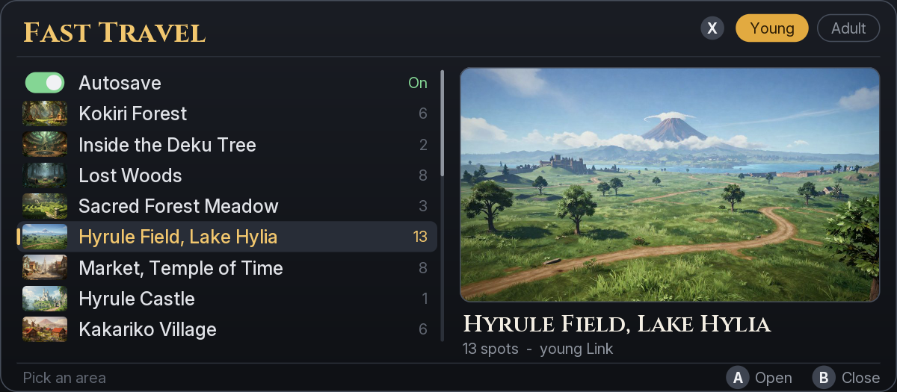

# Fast Travel: picture menu (draft)

This branch is a draft for discussion and is not a release. It builds samaBR85's picture menu (pull request #1) as a
patch file and reads the area pictures from the SD card. The released versions are on the `main` branch.

Fast Travel adds a menu to Ocarina of Time on Nintendo Switch 2. Pick an area and an arrival spot to warp there as
young or adult Link.



## Credits

- samaBR85: the picture menu (pull request #1). This covers the panel layout and drawing in `src/program/ui/`, the
  Inter and Cinzel text, the area pictures and their descriptions in `assets/`, the menu preview, and
  `tools/make_assets.py`.
- afiaka87: the original Fast Travel mod, and on this branch the patch-file build of the picture menu, loading the
  pictures from the SD card, and the L3 + R3 chord.

## What changed from pull request #1

- The menu builds as a patch file (`.pchtxt`) instead of a subsdk module. The glyphs are generated at build time and
  compiled in.
- The pictures are too large for a patch file (about 23 MB), so they are a separate file on the SD card. The JPEG
  decoder is removed. The pictures are stored uncompressed and read from the SD card when the menu needs them.
- The menu is drawn into one of two images in turn. Drawing into the image on screen showed a coloured flicker on
  every change.
- The menu opens with L3 + R3 (both sticks pressed in) instead of L3 alone.

## Requirements and install

Emulator only. The visited patch was tested on Windows in the Fritchii v5.5 emulator, started from the game list. It
targets game version 2.0.0 (update v131072), main build ID `E0F3CCFAF50065AE4EA01EB5AEB13B1A45DA3348`.

1. Build the patch and the picture file as described under Source and local build.
2. Close the game. In the emulator, right-click it and choose **Open Mod Data Location**. Copy the
   `fast-travel-patch` output folder there as `Fast Travel (Visited Patch)`.
3. Copy the picture file by hand to `fast-travel/pictures.bin` on the SD card. The mod does not install it. In an
   emulator the SD card is the `sdmc` folder in the emulator's data folder; Lichii and Fritchii on Windows use
   `%APPDATA%\eden\sdmc\fast-travel\pictures.bin`. On a Switch 2 it is `fast-travel/pictures.bin` at the root of the
   microSD card (not tested on hardware).
4. Enable **Fast Travel (Visited Patch)** and disable the older Fast Travel add-ons, Mirror Mode, and Graphics-Menu
   for this setup. The patch and those mods can use the same game hooks.
5. Start the game from the game list. Press L3 and R3 together after loading a save.

Without the picture file the menu still works and shows empty picture frames.

## Using the menu

- Press L3 + R3 to open or close the menu. Either stick can go in first. While the menu is closed, L3 or R3 on its
  own reaches the game.
- Each age has its own list: an Autosave row, then the areas. The list shows a small picture beside each area, and a
  large picture of the area under the cursor with its name and number of spots.
- Use D-pad up/down to move and left/right to page. Press A to open an area or warp to the selected spot. Press B to
  go back.
- Press X to switch between young and adult destinations. The mod goes through the Temple of Time when a warp needs
  an age change.
- Select **Autosave** and press A to toggle automatic saves for the session. The mod also holds automatic saves
  partway through an age change.
- A warp can wait while the game loads or a scene plays. The menu says why.

## Visited destinations

Each save has its own `fasttravel.sav` alongside `progress.sav`. The list fills as Link reaches arrival points or goes
through loading zones. For spots without a named arrival point, such as the Lost Woods clearings, the mod checks
whether Link comes within 5 m. A Fast Travel warp adds no destinations.

## The menu's pictures and fonts

The area pictures are illustrations made with an image generator (Magnific, Z-Image model) from a short description
of each place, written without the game's name; `assets/prompts.json` holds the descriptions. They suggest what each
place looks like and are not the game's art: no image from the game was used to make them. Each picture is named after
its area's `GameBancParam` name, and an area without a picture shows an empty frame.

The text uses Inter and Cinzel (SIL Open Font License 1.1), drawn ahead of time into anti-aliased glyphs;
`tools/fonts/` holds the fonts and their licenses.

## Source and local build

The feature source is in `src/program/`. The patch builder, startup code, and hook adapters are in `patch/`. The game
calls are resolved against your own dump.

The build used devkitA64 GCC 16.1.0. Prepare a local input directory containing flattened `main.bin` and `sdk.bin` at
their NSO memory offsets, `main.uncompressed.nso` with its valid NSO header, and the original SDK NSO at
`extract/exefs/sdk`. Keep these inputs outside the source checkout. From the Fast Travel folder, run the following with
your paths.

```powershell
uv run --no-project --with capstone --with pyelftools --with lz4 --with numpy --with pillow python patch/build_patch.py --game-dir <local-input-directory> --tool-bin <devkitA64-bin> --output-dir <local-output-directory>
uv run --no-project --with pillow python tools/make_assets.py pictures assets/areas <local-output-directory>/pictures.bin
```

The first command writes `fast-travel-patch/exefs/fast-travel-patch.pchtxt` and a separate IPS32 fallback. Use the
pchtxt for installation. `--all-places` builds the all-places version (not tested on this branch). The second command
writes the picture file.

Tested files (SHA-256):

- Visited patch: `cf92acf431fe9db565d10eca575457330e4525f0de8bb030304bfe5174622aca`
- `pictures.bin`: `24c8f03cfe9b0e538a2ff11203e66de3602244cdf9130e6205c1d05182386eb9`

## Known issues

- The subsdk module build and `tools/preview.cpp` are not updated for this branch. They still expect the picture and
  glyph file and the JPEG decoder from pull request #1.
- Moving to a new area reads that area's large picture from the SD card.

The source is MIT licensed. See `NOTICE.txt` for credits and the legacy module dependency.
