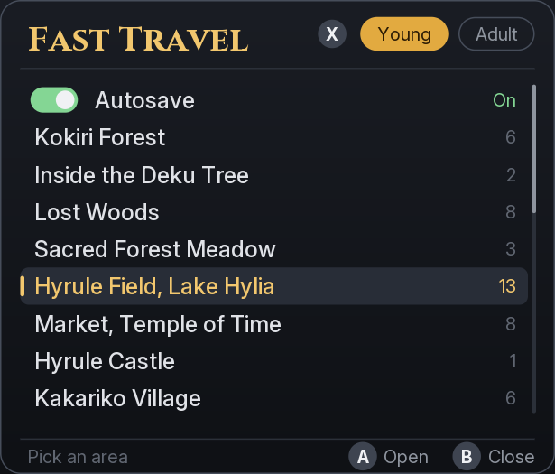

# Fast Travel v1.4.0

Version 1.4.0 adds the all-places patch: every area and spot for young and adult Link is in the menu from the start,
as in the v1.0.0 module, with the v1.3.0 menu. The visited patch is unchanged from v1.3.0 (same file).

Version 1.3.0 built samaBR85's picture menu (pull request #1) as a patch file. The menu shows the list alone by
default; with the player's own pictures on the SD card it shows a picture beside each area and a large picture of the
area under the cursor.

Fast Travel adds a menu to Ocarina of Time on Nintendo Switch 2. Pick an area and an arrival spot to warp there as
young or adult Link.

With pictures on the SD card:


Without pictures (the default):



Both images are PC renders of the menu's own drawing code (`src/program/ui/`) at the size used on a 1080p screen.

## Credits

- samaBR85: the picture menu (pull request #1). This covers the panel layout and drawing in `src/program/ui/`, the
  Inter and Cinzel text, the area pictures and their descriptions in `assets/`, and `tools/make_assets.py`.
- samaBR85: built-in BC1 pictures for the patch build (commit `2a90d2a`). The patch build does not use them; see
  "What changed from pull request #1".
- afiaka87: the original Fast Travel mod, and in v1.3.0 the patch-file build of the picture menu, the list-only
  layout, the larger menu, the JPEG reader for SD-card pictures, and the L3 + R3 chord; in v1.4.0 the all-places
  patch.

## What changed from pull request #1

- The menu builds as a patch file (`.pchtxt`) instead of a subsdk module. The glyphs are generated at build time and
  compiled in.
- No pictures are built in. A patch file can only add code and data in the game's free space, and the 47 pictures do
  not fit there: as BC1 at 256x144 they are about 837 KB after compression, against less than 100 KB of room left
  beside the menu's code. Instead the menu reads the player's own JPEG files from the SD card (see "Adding pictures").
- Without any picture file the menu shows the list alone: a narrow panel with the areas, no thumbnails and no
  picture. On an area's spot list the area's name replaces the "Fast Travel" title.
- The whole menu is 1.25 times larger than in pull request #1, text included: 1200 x 525 pixels with pictures and
  615 x 525 without, on a 1080p screen.
- The JPEG decoder from pull request #1 (picojpeg) did not fit in the free space; `src/program/ui/jpeg.cpp` is a
  smaller baseline JPEG reader written for this menu. It reads the picture in rows of 8 x 8 blocks and scales them as
  they arrive, so its memory does not depend on the picture's size.
- The menu is drawn into one of two images in turn. Drawing into the image on screen showed a coloured flicker on
  every change.
- The menu opens with L3 + R3 (both sticks pressed in) instead of L3 alone.

## Versions

| Add-on folder | Patch file | Destinations |
| --- | --- | --- |
| `Fast Travel (All Places Patch)` | `exefs/fast-travel-patch-all.pchtxt` | All 51 areas and 214 spots, young and adult, from the start |
| `Fast Travel (Visited Patch)` | `exefs/fast-travel-patch.pchtxt` | The spots Link has reached in the current save (see "Visited destinations") |

Both patches write the same free space and hooks in the game, so enable only one of them.

## Requirements and install

Emulator only. Tested on Windows from the game list, the all-places patch in Fritchii v5.7 and the visited patch in
Fritchii v5.5. Both patches target game version 2.0.0 (update v131072), main build ID
`E0F3CCFAF50065AE4EA01EB5AEB13B1A45DA3348`.

1. Build the patch as described under "Source and local build".
2. Close the game. In the emulator, right-click it and choose **Open Mod Data Location**. Copy the
   `fast-travel-patch-all` output folder there as `Fast Travel (All Places Patch)`, or the `fast-travel-patch` output
   folder as `Fast Travel (Visited Patch)`.
3. Optional: add pictures as described under "Adding pictures".
4. Enable that one folder and disable every other Fast Travel add-on, Mirror Mode, and Graphics-Menu for this setup.
   The patches and those mods can use the same game hooks.
5. Start the game from the game list. Press L3 and R3 together after loading a save.

## Adding pictures

The mod includes no pictures. To see pictures in the menu, make one JPEG file per area and copy them to the
`fast-travel/pictures/` folder on the SD card:

- In Lichii or Fritchii on Windows the folder is `%APPDATA%\eden\sdmc\fast-travel\pictures\`. In other emulators it
  is `fast-travel/pictures/` inside the emulator's `sdmc` folder. On a Switch 2 it is `fast-travel/pictures/` at the
  root of the microSD card (not tested on hardware).
- Name each file exactly as in the table below, including upper and lower case. Some areas share a picture.
- Use baseline JPEG, colour or grey. Progressive JPEG is not read: if a picture stays empty, save it again with the
  "progressive" option turned off. Most editors save baseline by default.
- Any size up to 4096 x 4096 works. The menu shows a 16:9 picture whole and crops other shapes to 16:9 around the
  centre. 960 x 540 is plenty: the large picture is 562 x 315 pixels on a 1080p screen.
- The menu looks for the folder once per game session, so restart the game after adding or removing pictures. If
  at least one area's file is there the menu uses the picture layout, and areas without a file show an empty frame.

| Area | Age | File name |
| --- | --- | --- |
| Kokiri Forest | young | `KokiriForest_Child.jpg` |
| Kokiri Forest | adult | `KokiriForest_Adult.jpg` |
| Inside the Deku Tree | both | `InsideTheDekuTree.jpg` |
| Lost Woods | young | `LostWood_Child.jpg` |
| Lost Woods | adult | `LostWood_Adult.jpg` |
| Sacred Forest Meadow | young | `SacredForestMeadow_Child.jpg` |
| Sacred Forest Meadow | adult | `SacredForestMeadow_Adult.jpg` |
| Forest Temple | adult | `ForestTemple.jpg` |
| Hyrule Field, Lake Hylia | young | `HyruleField_Child.jpg` |
| Hyrule Field, Lake Hylia | adult | `HyruleField_Adult.jpg` |
| Water Temple | adult | `WaterTemple.jpg` |
| Market, Temple of Time | young | `Market_Child.jpg` |
| Market, Temple of Time | adult | `Market_Adult.jpg` |
| Hyrule Castle | young | `HyruleCastle.jpg` |
| Ganon's Castle (outside) | adult | `GanonCastle.jpg` |
| Inside Ganon's Castle | adult | `InsideGanonCastle.jpg` |
| Kakariko Village | young | `KakarikoVillage_Child.jpg` |
| Kakariko Village | adult | `KakarikoVillage_Adult.jpg` |
| Graveyard | young | `Graveyard_Child.jpg` |
| Graveyard | adult | `Graveyard_Adult.jpg` |
| Shadow Temple | adult | `ShadowTemple.jpg` |
| Bottom of the Well | both | `BottomOfTheWell.jpg` |
| Death Mountain Trail | young | `DeathMountainTrail_Child.jpg` |
| Death Mountain Trail | adult | `DeathMountainTrail_Adult.jpg` |
| Dodongo's Cavern | both | `DodongoCavern.jpg` |
| Goron City | young | `GoronCity_Child.jpg` |
| Goron City | adult | `GoronCity_Adult.jpg` |
| Death Mountain Crater | young | `DeathMountainCrater_Child.jpg` |
| Death Mountain Crater | adult | `DeathMountainCrater_Adult.jpg` |
| Fire Temple | adult | `FireTemple.jpg` |
| Zora's River | young | `ZoraRiver_Child.jpg` |
| Zora's River | adult | `ZoraRiver_Adult.jpg` |
| Zora's Domain | young | `ZoraDomain_Child.jpg` |
| Zora's Domain | adult | `ZoraDomain_Adult.jpg` |
| Zora's Fountain | young | `ZoraFountain_Child.jpg` |
| Zora's Fountain | adult | `ZoraFountain_Adult.jpg` |
| Jabu-Jabu's Belly | young | `InsideJabuJabuBelly.jpg` |
| Ice Cavern | adult | `IceCavern.jpg` |
| Gerudo Valley | young | `GerudoValley_Child.jpg` |
| Gerudo Valley | adult | `GerudoValley_Adult.jpg` |
| Gerudo's Fortress | adult | `GerudoFortress_Adult.jpg` |
| Gerudo Training Ground | adult | `GerudoTrainingGround.jpg` |
| Haunted Wasteland | young | `HountedWasteland_Child.jpg` |
| Haunted Wasteland | adult | `HountedWasteland_Adult.jpg` |
| Desert Colossus | young | `DesertColossus_Child.jpg` |
| Desert Colossus | adult | `DesertColossus_Adult.jpg` |
| Spirit Temple | both | `SpiritTemple.jpg` |

The names are the game's own names for each area (`HountedWasteland` is spelled that way in the game).

## Using the menu

- Press L3 + R3 to open or close the menu. Either stick can go in first. While the menu is closed, L3 or R3 on its
  own reaches the game.
- Each age has its own list: an Autosave row, then the areas.
- Use D-pad up/down to move and left/right to page. Press A to open an area or warp to the selected spot. Press B to
  go back.
- Press X to switch between young and adult destinations. The mod goes through the Temple of Time when a warp needs
  an age change.
- Select **Autosave** and press A to toggle automatic saves for the session. The mod also holds automatic saves
  partway through an age change.
- A warp can wait while the game loads or a scene plays. The menu says why.

## Visited destinations

This applies to the visited patch only; the all-places patch keeps no record. Each save has its own
`fasttravel.sav` alongside `progress.sav`. The list fills as Link reaches arrival points or goes through loading
zones. For spots without a named arrival point, such as the Lost Woods clearings, the mod checks whether Link comes
within 5 m. A Fast Travel warp adds no destinations.

## The pictures and fonts in this folder

`assets/areas/` holds the pictures used to test the menu, in the format described above. They are illustrations made
with an image generator (Magnific, Z-Image model) from a short description of each place, written without the game's
name; `assets/prompts.json` holds the descriptions. They suggest what each place looks like and are not the game's
art: no image from the game was used to make them.

The text uses Inter and Cinzel (SIL Open Font License 1.1), drawn ahead of time into anti-aliased glyphs;
`tools/fonts/` holds the fonts and their licenses.

## Source and local build

The feature source is in `src/program/`. The patch builder, startup code, and hook adapters are in `patch/`. The game
calls are resolved against your own dump.

The build used devkitA64 GCC 16.1.0. Prepare a local input directory containing flattened `main.bin` and `sdk.bin` at
their NSO memory offsets, `main.uncompressed.nso` with its valid NSO header, and the original SDK NSO at
`extract/exefs/sdk`. Keep these inputs outside the source checkout. From the Fast Travel folder, run the following with
your paths.

```powershell
uv run --no-project --with capstone --with pyelftools --with lz4 --with numpy --with pillow python patch/build_patch.py --game-dir <local-input-directory> --tool-bin <devkitA64-bin> --output-dir <local-output-directory>
```

The command writes the visited patch, `fast-travel-patch/exefs/fast-travel-patch.pchtxt`, and a separate IPS32
fallback. Add `--all-places` for the all-places patch, `fast-travel-patch-all/exefs/fast-travel-patch-all.pchtxt`.
Use the pchtxt for installation. The two versions are listed once in `patch/build_patch.py` (`VISITED`,
`ALL_PLACES`).

`tools/preview.cpp` draws the menu on a PC in both layouts, and `tools/host/jpeg_check.cpp` runs the JPEG reader on a
PC; the build commands are at the top of each file.

The tested v1.4.0 patches have these SHA-256 values:

- all places: `fce813454a066cb0a288a766d2625032a86be326e57c90ea3588976073692b88`
- visited (the same file as v1.3.0): `d3b9046246e3b45818cf5e70d86705e2f0cb5925841c5fef1834ff9d9477ae25`

## Known issues

- The subsdk module build is not updated for v1.3.0 or v1.4.0; the subsdk5 downloads are the older v1.0.0 and
  v1.1.0.
- Moving the cursor to an area decodes its large picture, and the first menu open decodes the thumbnails shown. In
  Fritchii on the test PC that took about 60 to 70 ms per large picture and 35 to 45 ms per thumbnail for 960 x 540
  files; larger files take longer.

The source is MIT licensed. See `NOTICE.txt` for credits and the legacy module dependency.
